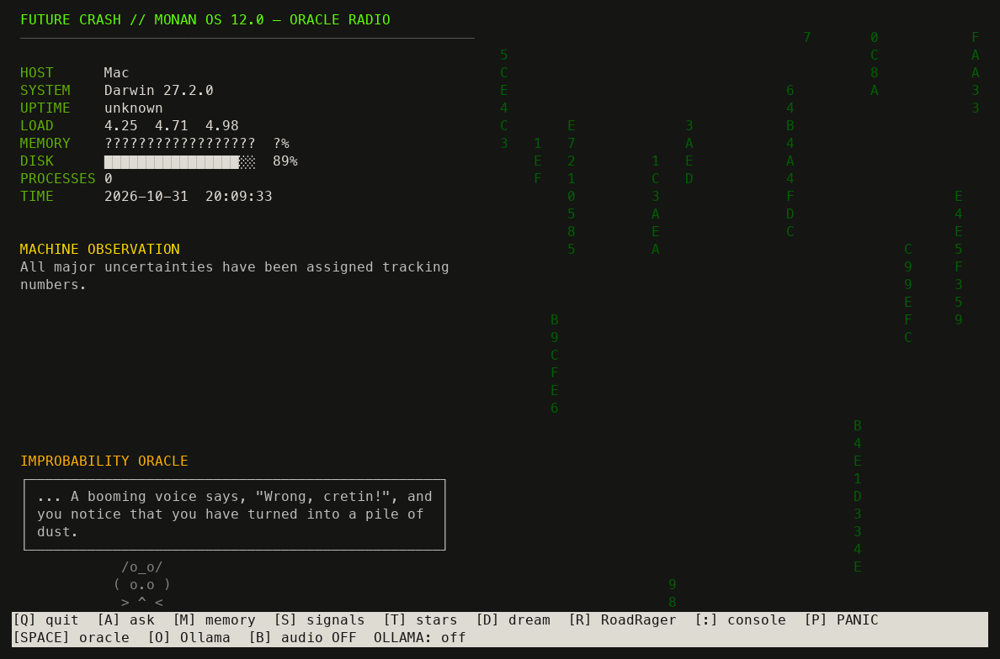

# Future Crash Oracle prototypes

A collection of standalone terminal experiments. The current combined Fabric
application lives in [FutureCrash-LOOK](https://github.com/WaltRudyJabsco/FutureCrash-LOOK). These scripts have separate
interfaces and version labels; they are not alternate launchers for that bundle.

| Entry point | Interface |
|---|---|
| `future_crash.py` | Future Crash Zero prototype |
| `future_crash_oracle.py` | MONAN OS 12.0 Oracle Radio |
| `future_crash_oracle_web.py` | MONAN OS web-enabled variant |
| `oracle_california85.py` | Coastal Workstation 85.2 |
| `oracle_sound_system_dub.py` | Dub Selector 2.2 |

```sh
python3 future_crash_oracle.py --help
python3 future_crash_oracle.py --mute --boot-seconds 0
```

The radio's `--ollama` flag enables occasional AI thoughts; it is a boolean,
whereas `future_crash.py --ollama URL` selects a server address. Check each
script's help before reusing flags between variants. Audio is optional.
[CLI reference](docs/CLI.md) contains help captured from all five scripts.



Fresh terminal capture from this source, with an isolated demo home, audio muted
and Ollama thoughts disabled. Historical screenshots and notes follow.

---


Future Crash Oracle

A tiny fictional operating system for your terminal.

Future Crash Oracle is a single Python program that turns a terminal window into a living retro-futuristic workstation.

It watches your machine, generates observations, dispenses Unix fortunes, talks through a local AI model, occasionally dreams, occasionally panics, and generally behaves like a slightly malfunctioning computer from an alternate 1980s.


Features

* Matrix rain
* Live system telemetry
* Ask the Oracle (local AI)
* Machine Memory
* Dream Mode
* Signal Room
* Panic button
* CRT reboot animations
* Unix fortune + cowsay
* One Python file

Installation

Use Homebrew (or your preferred package manager):

brew install fortune cowsay ollama

Download a model for Ollama.

A great all-around choice:

ollama pull qwen3:8b

If you prefer a model with fewer built-in guardrails, you can also experiment with community models such as Wizard Vicuna Uncensored or other compatible Ollama models. Different models have different capabilities, personalities, and safety characteristics, so choose one that matches how you want to use the Oracle.

Clone this repository:

git clone https://github.com/WaltRudyJabsco/future_crash_oracle.git
cd future-crash-oracle

Run it:

python3 future_crash_oracle.py --ollama --model qwen3:8b

The program expects standard Homebrew locations by default (for example /opt/homebrew/bin on Apple Silicon), but it will also work if the utilities are available on your shell’s PATH.

Optional: create a shortcut

Add an alias to your ~/.zshrc:

alias rzt='python3 "/path/to/future_crash_oracle.py" --ollama --model qwen3:8b'

Reload your shell:

source ~/.zshrc

Now simply type:

rzt

from anywhere.


Keyboard

Key	Action
A	Ask the Oracle
Space	New Fortune
M	Machine Memory
S	Signal Room
T	Terminal Constellation
D	Dream Mode
:	Command Console
P	Panic
O	Toggle Ollama
Esc	Return
Q	Quit

Philosophy

Future Crash Oracle isn’t trying to simulate a real operating system.

It’s trying to feel like you found a forgotten workstation from an alternate future—part system monitor, part AI companion, part science-fiction movie prop.

Leave it running on a spare monitor. Ask it questions. Press Panic only when absolutely necessary.

(You will press Panic.)


